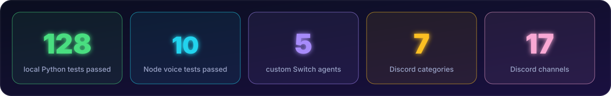
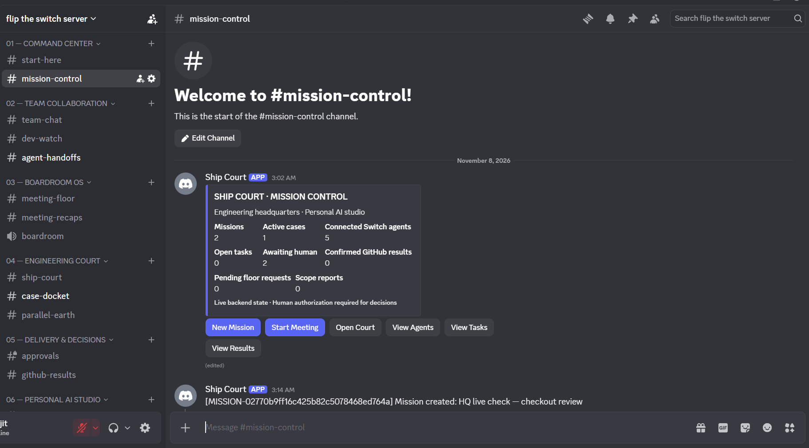
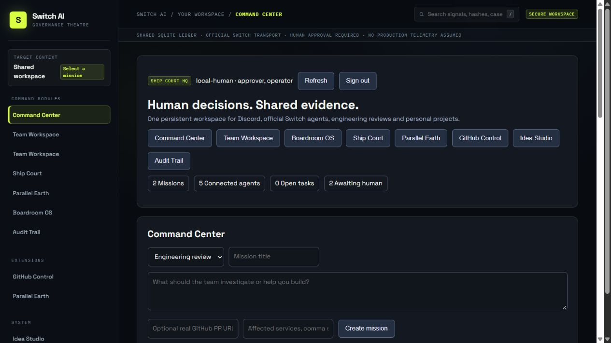
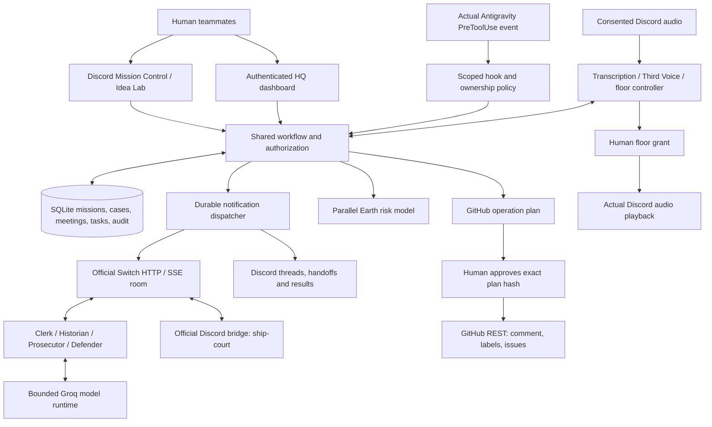
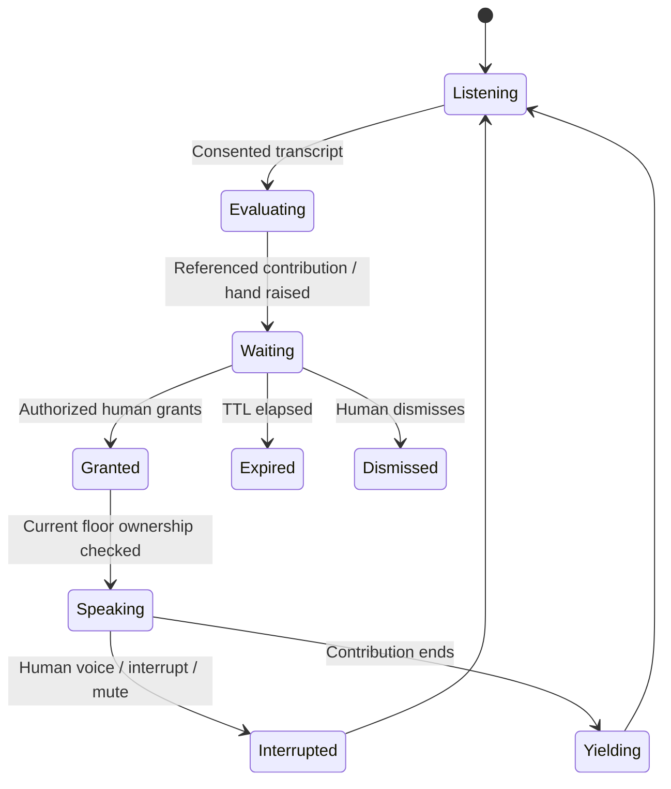
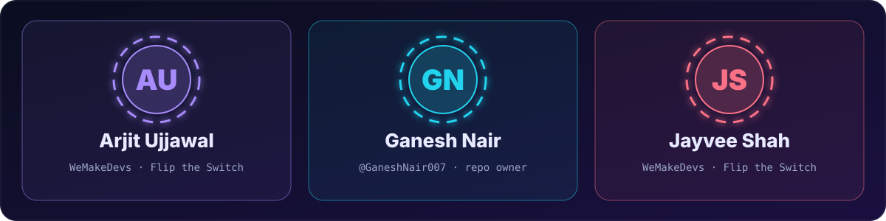

<p align="center"></p>

<p align="center"></p>

<p align="center"><b><i>“Your AI team investigates together. You make the decision.”</i></b></p>

<p align="center">Engineering headquarters. Personal Idea Studio. A meeting colleague who raises a hand.</p>

<p align="center"><a href="#the-problem">Problem</a> · <a href="#the-60-second-overview">See It</a> · <a href="#the-cast">Agents</a> · <a href="#why-switch-is-load-bearing">Why Switch</a> · <a href="#architecture">Architecture</a> · <a href="#verification-dashboard">Proof</a> · <a href="#the-5-superpowers">Superpowers</a> · <a href="#the-on-call-agent">Boardroom</a> · <a href="#end-to-end-lifecycle">Workflows</a> · <a href="#run-it-yourself">Setup</a> · <a href="#built-for-the-judges">Judges</a></p>

<p align="center">Built for <a href="https://www.wemakedevs.org/hackathons/switch"><b>Flip the Switch</b></a> by <b>WeMakeDevs</b> × <b>DevTools Academy</b> · powered by <a href="https://docs.switchagents.ai/"><b>Switch</b></a></p>

<p align="center"></p>

> [!IMPORTANT]
> **Free-first agent runtime. Human-controlled actions.** Five custom Python agents use your configured Groq API key and the official Switch HTTP/SSE protocol. No Claude Code or Codex subscription is required. Provider quotas still apply. Agents cannot approve themselves, execute a release, or silently turn a recommendation into a GitHub write.

<p align="center"></p>

## The Problem

Your coding agent knows its task. Your teammate's agent knows another. The meeting ends, the decisions disappear, and the pull request arrives with no shared account of what was agreed or what remains unproven.

**Ship Court HQ brings that work into one human–AI collaboration workspace.** People start missions in Discord or the web dashboard. A Clerk delegates through Switch to independent specialists. Evidence, objections, decisions and follow-up tasks remain attached to the project.

The same infrastructure supports two workflows:

| Workflow | Start with | Finish with |
|:--|:--|:--|
| **Engineering Headquarters** · `engineering_review` | A risky change, technical question or real GitHub PR | An advisory review, a human verdict, owned tasks and separately approved GitHub artifacts |
| **Personal Idea Studio** · `idea_studio` | A product idea, research question or personal project | Competing proposals, evidence-backed critique, a human-selected direction and a project you can resume |

<p align="center"></p>

## The 60-Second Overview

1. **A human creates a mission.** Use Discord **New Mission**, post an idea in `#idea-lab`, or use HQ.
2. **Switch carries the collaboration.** Clerk → Historian → Prosecutor → Defender → Clerk. Each handoff is a real room message with a returned event ID.
3. **The specialists share evidence.** They review supplied PR evidence, prior project decisions and earlier contributions. Missing proof stays missing; proposals are not completed tests.
4. **The human decides.** The native review stops at `AWAITING_HUMAN`. Record a direction, assign tasks or give a scoped case verdict.
5. **Results stay connected.** Discord threads and the dashboard show the same backend records. GitHub writes need a separately reviewed exact plan.

### Discord is the front door

<p align="center"></p>
<p align="center"><sub>Actual workspace screenshot supplied by the team. Seven categories organize the work; Mission Control updates one panel rather than spamming the channel. Zero confirmed GitHub results means no write is being claimed.</sub></p>

### HQ is the shared control room

<p align="center"></p>
<p align="center"><sub>Captured from the running application on November 8, 2026. The counts come from the backend. The password field clears after sign-in; no API key is embedded in this image.</sub></p>

**Eight connected views:** Command Center · Team Workspace · Boardroom OS · Ship Court · Parallel Earth · GitHub Control · Idea Studio · Audit Trail.

<p align="center"></p>

## The Cast

Five actual custom agents can share one Groq credential/model while keeping distinct instructions, registered identities and conversation context.

| Agent | Runtime role | What it contributes |
|:--|:--|:--|
| **Court Clerk** | `clerk` | Accepts work, delegates, synthesizes findings and asks for the human decision |
| **Incident Historian** | `historian` | Retrieves relevant supplied history and approved project decisions; distinguishes observed records from illustrative fixtures |
| **Prosecutor** | `prosecutor` | Challenges risks and unsupported assumptions; identifies missing evidence |
| **Defender** | `defender` | Tests the objections against supplied evidence; proposes mitigations and concedes real gaps |
| **Third Voice** | `third_voice` | A **meeting-only** colleague: evaluates consented discussion, requests the floor and speaks after a human grant |

**The human is the approver.** Discord author IDs and backend roles/scopes determine authority; a webhook name, agent persona or claim in chat cannot grant it.

Antigravity Guard, Parallel Earth, GitHub Operations and rollback-plan checks are backend services. They are not extra paid agents, and their presence in a roster does not make them live external integrations. Third Voice stays out of routine text review chains.

<p align="center"></p>

## The Trial

A technical question can open a case without pretending a repository was inspected. A PR review requires real PR metadata/diff evidence and affected services from the configured graph.

```mermaid
sequenceDiagram
    autonumber
    actor Human
    participant HQ as Discord / HQ
    participant CL as Court Clerk
    participant SW as Official Switch room
    participant HI as Historian
    participant PR as Prosecutor
    participant DE as Defender
    Human->>HQ: Create engineering_review mission
    HQ->>CL: Durable investigation request
    CL->>SW: Address Historian with job ID
    SW->>HI: Actual addressed SSE event
    HI->>SW: Evidence and handoff to Prosecutor
    SW->>PR: Addressed event
    PR->>SW: Risks and handoff to Defender
    SW->>DE: Addressed event
    DE->>SW: Mitigations and handoff to Clerk
    SW->>CL: Specialist results
    CL-->>Human: Advisory; AWAITING_HUMAN
    Human->>HQ: Scoped decision / case verdict
    HQ-->>Human: Persisted decision and owned follow-ups
    Note over Human,HQ: GitHub execution requires a separate exact-plan approval
```

Every native investigation has one `NATIVE-…` job ID, linked to its `MISSION-…` and optional case. Important handoffs are projected to `#agent-handoffs` **after Switch returns a receipt**. Discord narration does not replace the native handoff.

<p align="center"></p>

## Why Switch Is Load-Bearing

Switch is the coordination transport for native agents, not a badge attached to a local Python conversation.

| Responsibility | Actual implementation | Remove Switch and… |
|:--|:--|:--|
| Agent identities and room membership | Five registered custom agents in a real Switch room | Those room participants cannot collaborate |
| Addressed messages | Official HTTP posts and SSE event delivery | Clerk-to-specialist handoffs stop; there is no local-room fallback |
| Shared collaboration timeline | Native messages, addressed peers, event IDs and saved cursors | The shared native discussion and receipt trail stop |
| Discord room presentation | Official Switch bridge linked to `#ship-court` | Native agent messages no longer reach that linked room |

**The boundaries are deliberate:** Switch handles native room coordination. Ship Court's SQLite store holds application missions, cases, meeting state and audit events. Backend authorization enforces human decisions, CSRF/session checks and GitHub plan approval. Local tools and offline tests can run without Switch; **the native multi-agent workflow cannot**.

The adapter implements [Switch's agent protocol](https://docs.switchagents.ai/), checked against core revision `7bf37f8f82b45865b0f0bb207857fd9c25796172`. The shipped YAML template is also validated in CI. The active free-first path is the custom Groq adapter; the template is not evidence that optional paid harnesses are running.

<p align="center"></p>

## Architecture



<details>
<summary><b>Where to look in the repository</b></summary>

| Area | Entry points |
|:--|:--|
| Shared mission workflow | [`server/workspace.py`](server/workspace.py), [`server/unified_pipeline.py`](server/unified_pipeline.py) |
| Real custom agent transport | [`server/switch_protocol.py`](server/switch_protocol.py), [`server/switch_groq_worker.py`](server/switch_groq_worker.py), [`server/groq_agents.py`](server/groq_agents.py) |
| Discord organization and interaction | [`server/discord_setup.py`](server/discord_setup.py), [`server/discord_gateway.py`](server/discord_gateway.py), [`server/notifications.py`](server/notifications.py) |
| Dashboard and sessions | [`server/dashboard.html`](server/dashboard.html), [`server/hq_panel.html`](server/hq_panel.html), [`assets/hq.js`](assets/hq.js), [`server/dashboard_auth.py`](server/dashboard_auth.py) |
| Boardroom voice | [`voice/gateway.mjs`](voice/gateway.mjs), [`server/voice_bridge.py`](server/voice_bridge.py), [`server/floor_controller.py`](server/floor_controller.py), [`server/meetings.py`](server/meetings.py) |
| Antigravity and ownership | [`server/antigravity_hook.py`](server/antigravity_hook.py), [`server/scope_coordinator.py`](server/scope_coordinator.py), [`linking_antigravity/scope_guard/`](linking_antigravity/scope_guard/) |
| Models and deliverables | [`server/parallel_earth.py`](server/parallel_earth.py), [`server/github_client.py`](server/github_client.py) |
| Authorization and persistence | [`server/authorization.py`](server/authorization.py), [`server/store.py`](server/store.py) |

</details>

<p align="center"></p>

## Verification Dashboard

**Live verification recorded November 8, 2026.** A local fixture passing is not a claim that an external integration was exercised.

| Capability | Verified state | Evidence / limit |
|:--|:--|:--|
| Official Switch + Groq | **Live** | Five connected SSE clients; two native four-role investigations completed |
| Engineering + Idea Studio | **Live agent collaboration** | Both operator-initiated checks reached `AWAITING_HUMAN`; no human approval was invented |
| Discord HQ | **Live** | Seven categories, 17 channels, working panel, two mission threads and 16 related receipt-backed deliveries |
| Restart/persistence | **Live + locally tested** | Both native results survived restart; all five clients reconnected |
| Dashboard | **Live UI + tested API** | Actual counts, authenticated screenshot, five-minute HttpOnly sessions and protected mutations |
| Local Python suite | **128 passed** | Workflow, scope, identity, persistence, transport, exact-plan and HTTP tests; live-provider modules are run separately |
| Voice/audio suite | **10 passed** | PCM/Opus, speech filtering, interruption and floor input checks |
| Antigravity event pipeline | **Contract tested** | Authenticated hook → evidence/case → real-worker dispatcher; an actual IDE-originated tool event remains to be captured |
| Full voice meeting | **Live verification pending** | Gateway running; an earlier audio check was heard. Full microphone → transcript → hand → grant → speech → interruption → recap still needs a human call |
| GitHub writes | **Controlled transport tested** | Exact plan, human verdict, head-SHA check and confirmed URLs; no manual live write test was performed |
| Parallel Earth | **Modeled** | Reproducible dependency/exposure/request model; no real traffic, outage or rollback is implied |

The live checks used **authenticated local operator HTTP intake**, not fabricated Discord human messages. The new Discord modal/Idea Lab intake and actual human decision remain explicit demonstration steps.

**Inspect the proof:** [redacted live receipts](docs/evidence/hq-live-2026-11-08.json) · [implementation and limitations](docs/HQ_IMPLEMENTATION.md) · [CI workflow](.github/workflows/ci.yml).

<p align="center"></p>

## The 5 Superpowers

<details open>
<summary><b>1 · Antigravity Auto-Subpoena</b> — a scope conflict becomes shared work</summary>

A frontend, pricing or checkout agent has a human-provisioned assignment and path ownership policy. An authenticated real tool violation is stored, attached to its server-assigned mission/case, queued to Switch, and projected to `#dev-watch` and `#case-docket`. The same Groq team investigates it. Human scope exceptions are explicit and limited to exact files.

**Use it:** provision a scoped hook identity, set `hq:assignment`, enable the real `PreToolUse` command, then observe an actual editor event. The hook consumes stdin; it does not manufacture the live event. Arbitrary nested scripts and outside processes are not fully contained by static path checks. [Installation and three-teammate setup](docs/HQ_SETUP.md#antigravity--actual-editor-event-required).

</details>

<details>
<summary><b>2 · Parallel Earth</b> — model the cost before choosing a rollout</summary>

Select a real case with known affected services. Set downtime, request count and failure probability, then run the Python model from HQ. It calculates downstream dependencies, estimated exposure and a synthetic pass rate with explicit assumptions. The result is stored with the case and projected to `#parallel-earth`.

**Use it:** HQ → **Case, research and delivery controls** → **Run case model**, or `!court hq:simulate {"mission_id":"MISSION-ID","downtime_minutes":15,"requests":1000,"failure_probability":0.01}`. It does not spin up a production twin, verify a real rollback or measure an actual SLA.

</details>

<details>
<summary><b>3 · Third Voice + Boardroom OS</b> — an AI colleague with a right-to-speak protocol</summary>

Participants opt in individually to transcription. Third Voice evaluates the supplied discussion and approved decisions, cites actual meeting references and raises an expiring hand when it has something relevant. Human permission controls speech. One AI owns the floor per meeting; human voice activity interrupts playback.

**Use it:** link a meeting, join the Discord voice channel, run `!voice start MISSION-ID`, then `!voice consent`. Six controls handle **Grant Floor**, **Text Instead**, **Dismiss**, **Interrupt**, **Mute Agent** and **End Meeting**. [Full voice checklist](#the-on-call-agent).

</details>

<details>
<summary><b>4 · One workspace across Discord, HQ and Idea Studio</b> — context survives the conversation</summary>

Mission Control creates real missions and meetings, shows actual connected agents, and exposes tasks/results through backend-checked controls. Idea Lab captures personal projects and uses the same Switch team. Tasks from linked cases and meetings are projected from their original records, so the dashboard and Discord do not maintain rival copies.

**Use it:** create a mission, record a direction, assign work, finish tasks and resume the project later. SQLite retains decisions and context. The channel setup command is idempotent, reuses existing channels and protects approvals/backstage channels. [Command reference](docs/HQ_SETUP.md).

</details>

<details>
<summary><b>5 · Human-approved GitHub Operations</b> — turn a verdict into traceable artifacts</summary>

A reviewed PR case can produce a comment, governance labels and follow-up issues for conditions. Planning has no write side effect. Execution requires an authorized human, the exact current plan hash, and an unchanged open PR head. Confirmed API URLs are posted to `#github-results`; unknown/failing operations are not relabeled successful.

**Use it:** record the case verdict → **Review exact GitHub plan** → inspect the operations → explicitly **Execute reviewed plan**. Restrict the token to the intended repository and create the required labels first. There is no automatic deployment, rollback branch, merge or production rollback in this workflow. [Credentials and labels](docs/CREDENTIALS.md#3-github--evidence-and-approved-deliverables).

</details>

<p align="center"></p>

## The On-Call Agent

**Third Voice is a Groq-powered meeting colleague**, similar to having a conversational assistant on the call. It is not a required ChatGPT subscription or another routine text reviewer.



| Step | What you do | What should happen |
|:--|:--|:--|
| Start | **Start Meeting** in Mission Control; join boardroom; `!voice start MISSION-ID` | Bot joins and discloses transcription; meeting links to the mission |
| Consent | Each participant sends `!voice consent` | Only their opted-in speech is sent to Groq; `!voice revoke` stops capture |
| Discuss | Speak a specific question or contradiction | Transcript enters the meeting; a relevant contribution may raise a hand in `#meeting-floor` |
| Control | Grant, request text or dismiss | The backend checks exact human identity, meeting scope, expiry and floor ownership |
| Interrupt | Speak while the AI plays, or choose **Interrupt** / **Mute Agent** | Playback stops; floor state updates |
| End | `!voice stop` or **End Meeting** | One source-linked recap is persisted and sent to `#meeting-recaps` |

Recaps preserve discussion references, explicitly approved decisions, assigned tasks and related mission IDs. Casual conversation is never treated as GitHub or release authorization. `!voice test` is an audio check, not proof of intelligent meeting participation.

<p align="center"></p>

## End-to-End Lifecycle

### Demo A · Engineering Headquarters

In `#mission-control`, choose **New Mission**, select `engineering_review`, and enter a question such as:

> Review checkout payment retries. Identify the timeout, retry-budget and idempotency requirements, then summarize the missing evidence for my decision.

Leave PR/services empty for a question-only case. For a repository review, supply your real PR and affected services. Send the exact `hq:start` command the bot returns. Follow the native specialists in `#ship-court`, inspect the case, and make a real human decision.

```text
!court hq:decision {"mission_id":"MISSION-ID","text":"Use bounded retries; require idempotency and load evidence"}
!court hq:task {"mission_id":"MISSION-ID","description":"Collect checkout load evidence","owner_id":"discord:YOUR-USER-ID"}
```

For a reviewed PR case, a binding verdict is separate from that general direction:

```text
!court hq:verdict {"mission_id":"MISSION-ID","command":"CONDITIONS collect load evidence"}
!court hq:github-plan {"mission_id":"MISSION-ID"}
```

Review the returned operations and hash before any explicit `github-execute`. A question-only case needs actual PR evidence attached before repository operations.

### Demo B · Personal AI Idea Studio

Post in `#idea-lab`:

> I want to build a workspace where students and AI coding agents collaborate. Compare two MVP directions, challenge the assumptions and propose an experiment to validate demand.

The mapped human's message creates an `idea_studio` project. Specialists collaborate through Switch, label unsupported claims unverified, and return a question for the human. Approve a direction, assign a task and continue later:

```text
!court hq:decision {"mission_id":"MISSION-ID","text":"Prototype the shared task board; validate through five interviews"}
!court hq:task {"mission_id":"MISSION-ID","description":"Prepare interview questions","owner_id":"discord:YOUR-USER-ID"}
!court hq:task-update {"mission_id":"MISSION-ID","task_id":"TASK-ID","status":"DONE"}
!court hq:transition {"mission_id":"MISSION-ID","status":"COMPLETED"}
!court hq:resume {"mission_id":"MISSION-ID"}
```

Completion requires an explicit human decision for the current work cycle and resolved tasks. Resuming retains the history and starts a new native job; old approval does not automatically complete the new work.

<p align="center"></p>

## Run It Yourself

**Choose your path:** local tests need Python only; live multi-agent collaboration adds Switch + Groq; Discord and voice add their own credentials. The offline simulation is explicitly labeled and does not substitute for the live path.

### 1 · Clone and install

Use **Python 3.12**, Git, and **Node 24.18+** for optional voice. Start from a fresh clone; `.env`, `.venv` and `.runtime` are gitignored.

```bash
git clone --branch main https://github.com/GaneshNair007/switch-AI.git
cd switch-AI
python3.12 -m venv .venv
source .venv/bin/activate
python -m pip install -r requirements.txt -r requirements-discord.txt
cp .env.example .env
python -m server.configure
```

<details>
<summary><b>Windows PowerShell equivalent</b></summary>

```powershell
git clone --branch main https://github.com/GaneshNair007/switch-AI.git
Set-Location switch-AI
py -3.12 -m venv .venv
.\.venv\Scripts\python.exe -m pip install -r requirements.txt -r requirements-discord.txt
Copy-Item .env.example .env
.\.venv\Scripts\python.exe -m server.configure
```

Use `.\.venv\Scripts\python.exe` in place of `python` below if you have not activated the environment. Copy `.env.example` only on a fresh clone: do not overwrite existing local credentials.

</details>

`server.configure` generates the local workspace credential and its hashed identity without printing secrets. Save every service key in the **root `.env`**, never in README, Discord, a URL or a committed configuration file.

### 2 · Check the code without external providers

```bash
python scripts/run.py pytest -q tests/ linking_antigravity/tests/ --ignore=tests/test_provider_integration.py --ignore=tests/test_live_switch_gate.py
python -m server.local_courtroom_simulation
```

The simulation stops for human authorization. The local suite uses controlled external transports; it does not post GitHub comments or impersonate a real IDE event. CI additionally validates the official Switch template.

### 3 · Configure Groq and the real Switch room

1. Create a key in [Groq Console](https://console.groq.com/keys). Set `GROQ_API_KEY` and an available `DEFAULT_GROQ_MODEL` in `.env`. The recorded live checks used `openai/gpt-oss-120b`; availability/quotas depend on your account. No optional paid harness is required.
2. Install and start the official [Switch runtime](https://docs.switchagents.ai/). Use its actual API URL, not the Ship Court `8080` URL. Set `SWITCH_URL` and your server's agent-registration credential as `SWITCH_REGISTRATION_TOKEN`.
3. Register the five custom agents:

```bash
python -m server.setup_switch --register
```

4. In Switch, create a room, add the five registered `shipcourt-*` agents and your human user, and connect its Discord bridge to `#ship-court` if using Discord. Allow the verified human and owner agents to address the team. Do not make every external account an approver. The room ID, agent API IDs, transport sender IDs and Discord user ID are different identifiers.
5. Copy [the sender-map example](config/switch-senders.example.json) to `.runtime/senders.json`. Replace every placeholder with the **actual opaque sender ID observed in Switch room events**. Keep agent IDs under `agents` and verified human sender IDs under `humans`; do not derive them from display names or UUIDs.
6. Generate the local connection configuration:

```bash
python -m server.setup_switch --configure --room-id YOUR_SWITCH_ROOM_ID --sender-map .runtime/senders.json
```

This writes all five `SWITCH_CLIENTS` entries, restores existing returned agent keys and saves human intake mappings in `.env`. It does not create a second set of agents or grant human approval rights to an agent.

**Detailed runtime setup:** [Switch + Groq guide](docs/SWITCH_GROQ.md), including the local Console registration-key fallback and identity-policy troubleshooting. The shared free-tier budget defaults to one inference at a time, six calls/minute and 6,000 reserved tokens/minute. A review can take several minutes.

### 4 · Set up Discord HQ

Create a text application/bot at the [Discord Developer Portal](https://discord.com/developers/applications). Save `DISCORD_BOT_TOKEN`, `DISCORD_APPLICATION_ID` and `DISCORD_GUILD_ID`. Enable **Message Content** and **Server Members** intents for the Switch text bridge. Invite it to a server you administer.

Add your actual Discord user ID to `DISCORD_MEMBERS` in `.env`:

```dotenv
DISCORD_MEMBERS={"YOUR_DISCORD_USER_ID":{"roles":["operator","approver"],"scopes":["*"]}}
```

That is an owner setup example; provision narrower roles/scopes for teammates and viewer access for judges. A bot or webhook persona cannot approve. Runtime needs View Channels, Send Messages, Embed Links, Attach Files, Read Message History, and Manage Webhooks for Switch's named agents. Mission threads need Create Public Threads. Setup additionally needs temporary Manage Channels/Manage Roles.

```bash
python -m server.discord_setup --plan
# Inspect the exact target server, reuse/create operations and private permissions first.
python -m server.discord_setup --apply --approve-guild YOUR_DISCORD_GUILD_ID
python -m server.discord_setup --validate
```

The plan creates seven categories and 17 channels, reuses existing matches, and never deletes channels. `approvals`, `agent-traces` and `system-alerts` are restricted. IDs are saved to `.runtime/discord_channels.json`. Remove the two temporary setup permissions afterward. Creating a Discord channel does not create a Switch room: link the real room separately. [Full layout and manual fallback](docs/HQ_SETUP.md#discord-organization).

### 5 · Start HQ and send the first real task

```bash
python -m server.main --serve --port 8080
```

Open **http://127.0.0.1:8080**. Sign in with the generated **`SHIPCOURT_TOKEN`** value from your local `.env`, not a Groq or Discord key. The browser receives a five-minute HttpOnly session; changes need CSRF protection. Use HTTPS for remote access.

In `#mission-control`, use **New Mission** and the returned `!court hq:start` command. For a direct native room check, send from your own verified Discord account:

```text
@shipcourt-clerk !shipcourt discuss Assess checkout timeout and idempotency risks. Ask the specialists, identify missing evidence, and summarize for my decision.
```

Watch actual agent messages in `#ship-court`, and use HQ's agent view or authenticated `/api/readiness` to inspect connection state. Missing/disconnected services remain visibly unavailable. Keep only one backend process per client configuration.

### 6 · Enable optional voice, GitHub and Antigravity

| Capability | Configure | Run / next step |
|:--|:--|:--|
| **Discord voice** | Separate voice bot token as `DISCORD_VOICE_BOT_TOKEN`; same guild; Connect/Speak and gateway intents | `python -m server.configure --voice-gateway`, `npm ci --prefix voice --ignore-scripts`, then `node --env-file=.env voice/gateway.mjs` |
| **GitHub** | `GITHUB_TOKEN` scoped to the chosen repository; PR/issues permissions; existing `ship-court:approved`, `ship-court:conditional`, `ship-court:blocked` labels | Supply a real PR, record the verdict, inspect the exact plan, then explicitly approve execution |
| **Antigravity** | `python -m server.configure --hook frontend-agent`; set hook agent ID; provision assignment and real workspace hook | Follow [the actual editor setup](docs/HQ_SETUP.md#antigravity--actual-editor-event-required); restart backend after adding the scoped identity |
| **Research** | Explicit HTTPS source URLs and `SHIPCOURT_RESEARCH_HOSTS` allowlist | Use HQ **Verify sources**; unsupported factual claims stay unverified |

Restart the affected backend/gateway after configuration changes. The optional harness names `antigravity`, `claude_code`, `codex` and `opencode` are compatibility/configuration points, not claims that those sessions are implemented and online. The operational agent runtime here is `groq_custom`.

<details>
<summary><b>CLI, voice tests and common setup failures</b></summary>

```bash
# Same backend as Discord and HQ; local credential loaded without being printed
python -m server.hq_cli snapshot
python -m server.hq_cli create --args-file .runtime/mission.json
# Voice tests need installed Node dependencies, not a live call
node --test voice/audio.test.mjs voice/transcription.test.mjs
```

| Symptom | Check |
|:--|:--|
| No connected agents | Actual Switch URL, room membership, saved agent keys, `SWITCH_CLIENTS`, and receiver status |
| Agent rejects a human's address | Switch addressing policy and the real ExternalUser/transport identity; a matching display name is insufficient |
| Handoff never reaches the peer | Exact observed sender IDs, registered mention names and owner-agent addressing permissions |
| Discord command denied | Correct guild, real human user ID in `DISCORD_MEMBERS`, required backend role/scope; bots are intentionally rejected |
| No Mission Control panel | Saved channel map, bot View/Send/Embed permissions, enabled intents, one running gateway |
| Voice hears no speech | Voice permissions, individual consent, actual mic input, provider access and `GROQ_STT_LANGUAGE` |
| GitHub execution rejected | A real open PR, recorded human verdict, current head SHA, correct scopes and exact reviewed plan hash |

More: [credentials](docs/CREDENTIALS.md) · [HQ setup and demos](docs/HQ_SETUP.md) · [Switch agent guide](docs/SWITCH_GROQ.md).

</details>

<p align="center"></p>

## The Artifact: An Auditable Release Brief

A human verdict produces a case-linked Release Brief: decision, actor, PR/head evidence, advisory findings, conditions, owners and provenance. It is an auditable application record; this path does not claim a cryptographic signature or an executed deployment.

| Artifact | How to verify it |
|:--|:--|
| Native investigation | Job ID plus actual Switch handoff receipts |
| Human decision | Authenticated actor and scoped audit event; recommendation alone is not permission |
| Follow-up work | Owned tasks stored on their originating mission/case/meeting |
| GitHub delivery | Returned external URLs and `CONFIRMED` operation status |
| Meeting recap | Source-linked discussion, approved decisions, tasks and related mission |

The captured engineering mission `MISSION-02770b9ff16c425b82c5078468ed764a` and personal mission `MISSION-226ef7f0fecb405f92413088b66afe87` both await their real human decision. These are evidence IDs from our development workspace, not hardcoded IDs to copy into your deployment.

<p align="center"></p>

## Built for the Judges

The [official judging criteria](https://www.devtoolsacademy.com/hackathons/flip-the-switch#judging) emphasize four things:

| Criterion | Weight | Where to inspect this project |
|:--|:--:|:--|
| **Use of Switch** | **30%** | Five actual registered custom clients, addressed SSE/HTTP handoffs, room membership, Discord bridge and receipt evidence; disconnecting Switch stops native collaboration |
| **Technical execution** | **25%** | Reproducible setup, CI, deterministic floor/authorization logic, persistent missions, exact GitHub plan approval and regression tests |
| **Creativity and impact** | **25%** | Adversarial engineering review plus personal Idea Studio, scoped development events, modeled risk and a meeting colleague who asks to speak |
| **Presentation and documentation** | **20%** | Actual Discord/HQ screenshots, architecture, two demo scripts, clear setup and an honest capability matrix |

**Submission checklist:** public repository · short video of the real workflow running · README explaining the connected agents, channel setup and reproduction. A blog is optional. This README does not stand in for a recorded demo or a submitted entry. [Official submission guidance](https://www.devtoolsacademy.com/hackathons/flip-the-switch#what-you-submit).

**For the demo video:** show a real human creating a mission, the actual native handoffs, shared evidence, the human decision and its persisted result. Demonstrate professional and personal use separately. Include the full voice/IDE sequences only after verifying them live; otherwise identify those gates explicitly.

<p align="center"></p>

## The Team

<p align="center"></p>

- **Arjit Ujjawal**
- **[Ganesh Nair](https://github.com/GaneshNair007)** — repository owner
- **Jayvee Shah**

**Primary track:** Track 01 — Best Business Workflow · **Also targeting:** Track 02 — Best Personal or Creative Workflow.

**Links:** [Repository](https://github.com/GaneshNair007/switch-AI) · [Hackathon](https://www.wemakedevs.org/hackathons/switch) · [Switch runtime](https://github.com/sandbox-quantum/switch) · [Switch docs](https://docs.switchagents.ai/) · [MIT License](LICENSE).

<p align="center"></p>
