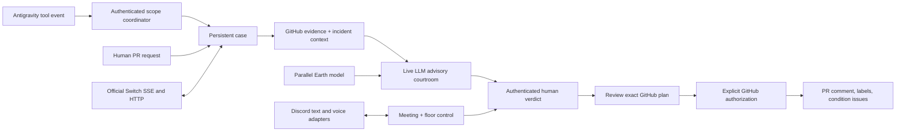
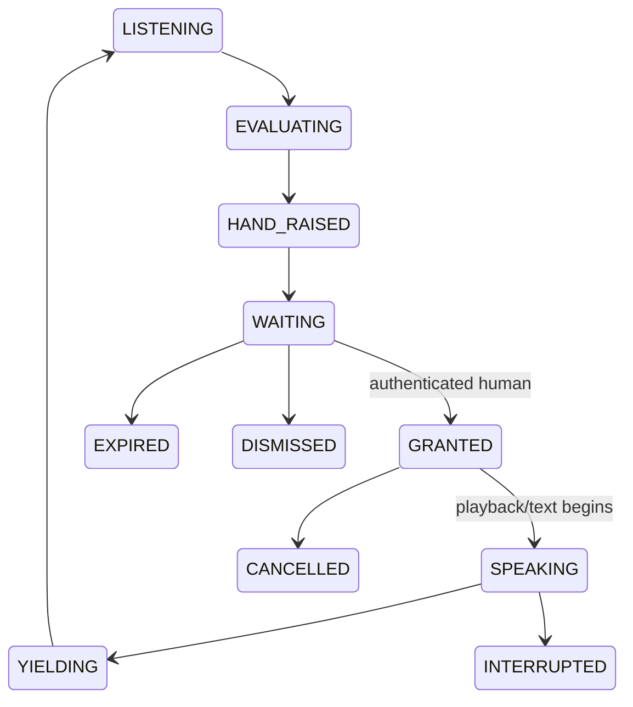

# SHIP COURT × BOARDROOM OS

**The AI engineering team that meets, debates, simulates, and ships.**

Ship Court connects developer scope checks, human–AI meetings, adversarial PR review, modeled deployment risk, and human-approved GitHub deliverables. The development branch is `arjit`.

**Current status:** the integrated local workflow and security boundaries are tested. GitHub public evidence retrieval was verified live. Switch collaboration, Discord communication, Groq inference, voice calls, staging workloads, and GitHub writes still need live verification with configured services. See [verification and limitations](docs/VERIFICATION.md).

## What works together



The clerk coordinates cases; the historian supplies labeled incident context; prosecutor and defender analyze supplied evidence; the AI reviewer produces an advisory recommendation. An authenticated human issues the binding decision. Model output cannot grant permissions or execute GitHub operations.

Switch's two native clients can hand work from clerk to reviewer through actual room messages. They use registered agent keys, SSE delivery, heartbeats, room membership, and HTTP operations. Disconnecting Switch stops that native handoff. The local Python room remains an explicitly separate development harness.

## Run locally

Use Python **3.12**. On this checkout an isolated environment already exists at `.runtime/venv`.

```powershell
# Clean checkout:
python -m venv .venv
.venv\Scripts\python.exe -m pip install -r requirements.txt -r requirements-discord.txt
.venv\Scripts\python.exe -m server.configure
.venv\Scripts\python.exe -m server.main --serve --port 8080

# Existing prepared checkout:
.runtime\venv\Scripts\python.exe -m server.configure
.runtime\venv\Scripts\python.exe -m server.main --serve --port 8080
```

Open `http://127.0.0.1:8080`. The **Release workflow** panel uses the same authenticated services as the CLI. Read your generated `SHIPCOURT_TOKEN` from the gitignored `.env` and enter it in the access field; the dashboard keeps it in memory. Keep the server on loopback unless you put it behind HTTPS.

Configure external services only when ready, using the [single credentials checklist](docs/CREDENTIALS.md). `server.configure` refuses to overwrite an existing credential. Copy individual settings from `.env.example` into `.env`; do not replace a generated `.env` wholesale.

## Workflow

1. Open a real GitHub PR and name affected services from the configured dependency graph.
2. Run the advisory review. Retrieved PR title, body, patch excerpts, reviewed head SHA, incident fixtures and modeled risk feed the existing LLM engine.
3. Inspect the evidence and record **BLOCK**, **CONDITIONS**, or **APPROVE** as an authenticated approver.
4. Preview GitHub changes. Execution requires a separate approval of that exact plan hash and rejects changed PR heads.
5. Inspect returned GitHub URLs and correlated audit events.

No deploy, rollback command, merge, or force push is executed. A GitHub failure is retained as failed/partial, including confirmed URLs obtained before failure. Replay uses durable operation records and remote markers to avoid repeating completed work.

## Discord and meetings

The optional Python Discord gateway supports authenticated `!court` commands, slow reviews without interaction timeouts, and actual **Grant Floor / Text Instead / Dismiss** buttons. Exact Discord user IDs are provisioned server-side; bots and display-name impersonation cannot approve.

Meeting records include consent, transcript entries, approved decisions, assigned tasks, owners, source references, and summaries. Decisions and assignments persist after meetings end. See [commands and demo](docs/DEMO.md).



One active AI floor owner is enforced per meeting. Requests have TTLs, deterministic priority order, duplicate suppression and cooldowns. Restart interrupts outstanding grants; it never resumes speech automatically.

The optional Node voice gateway uses `@discordjs/voice` with DAVE, receives consented audio, sends it to Groq transcription, generates grounded hand requests, and plays Groq TTS only after a floor grant. Human speech interrupts pending or active playback. Raw audio is held briefly in bounded memory and is not stored on disk. **Actual Discord voice remains unverified until a real call is tested.**

## Antigravity

The bundled Scope Guard hook retrieves versioned assignments, denies unknown assignments, checks ownership/path boundaries, spools failed reports, and posts authenticated violations to `/api/v1/violations`. A violation opens a durable case; `/api/cases/attach` links its real PR before review. Human-approved exceptions name exact files and persist for the assignment's lifetime. They are not blanket ownership grants.

Configure the actual IDE/CLI hook according to [the existing integration guide](linking_antigravity/README.md), plus [current backend configuration](docs/CREDENTIALS.md). Local hook-to-HTTP delivery is tested; actual editor installation must still be verified on the developer machine.

## Parallel Earth and research

The bundled dependency graph is illustrative. Financial exposure is a model that sums node rates; shared revenue can be double-counted. Canary success is a seeded Bernoulli model with an explicit failure probability. Neither result is an observed production measurement. Unsupported target services and invalid numeric inputs fail explicitly. Reports never claim an unexecuted rollback succeeded.

An optional operator-configured staging endpoint can be sampled with bounded GET requests. It reports observed success rate and latency, without injecting faults or executing rollback.

Research fetches bounded content only from operator-allowlisted HTTPS hosts, rejects redirects and invented source IDs, and records the LLM's supported/contradicted/inconclusive assessment with source excerpts. That assessment is not independent factual proof.

## Tests

```powershell
.runtime\venv\Scripts\python.exe -m pytest -q
.runtime\venv\Scripts\python.exe switch/validate_template.py
npm.cmd ci --prefix voice --ignore-scripts
node --test voice/audio.test.mjs
```

The local integration tests exercise real HTTP delivery; external GitHub/LLM responses are explicitly controlled fixtures. Missing live provider credentials produce skips, not fake successes. Official Switch lint runs when `switch_core` is installed; otherwise the validator explicitly reports only structural checks. CI covers `main` and `arjit`, the Scope Guard suite, pinned official Switch lint, and local voice tests.

## Documentation and submission

- [Credentials and account setup](docs/CREDENTIALS.md)
- [Runnable demo and command reference](docs/DEMO.md)
- [Verification, evidence, and known limitations](docs/VERIFICATION.md)
- [Original product narrative and sample transcripts](docs/HISTORICAL_README.md)

Target: Flip the Switch, Best Business Workflow. Submission is **not yet live-verified** and has not been published or submitted. Preserve a real human message, Switch handoff, authenticated decision, GitHub artifact URL, and common case ID in the final demonstration.
