<p align="center"></p>

<p align="center"></p>

<p align="center"><b><i>“We built a courtroom where AI agents must argue against a deployment before a human judge lets it ship.”</i></b></p>

<p align="center"><a href="#the-problem">The Problem</a> · <a href="#the-60-second-overview">Overview</a> · <a href="#the-cast">Cast</a> · <a href="#the-trial">Live Trial</a> · <a href="#why-switch-is-load-bearing">Why Switch</a> · <a href="#architecture">Architecture</a> · <a href="#verification-dashboard">Verification</a> · <a href="#the-5-superpowers">Superpowers</a> · <a href="#end-to-end-lifecycle">Lifecycle</a> · <a href="#run-it-yourself">Run It</a> · <a href="#the-team">Team</a></p>

<p align="center">Built for <a href="https://www.wemakedevs.org/hackathons/switch"><b>Flip the Switch</b></a> by <b>WeMakeDevs</b> × <b>DevTools Academy</b> · powered by <a href="https://docs.switchagents.ai/"><b>Switch</b></a></p>

<p align="center"></p>

<p align="center"></p>

## The Problem

Traditional AI code review is passive and shallow (“Looks good to me!”). Catastrophic production outages happen because nobody rigorously argued **against** shipping, and nobody verified the rollback.

Modern teams suffer from a double fragmentation:

1. **The working-phase blind spot.** Teammates using autonomous coding agents (Antigravity, Claude Code, Codex, Cursor) edit overlapping service contracts, schemas and shared libraries with no cross-machine awareness.
2. **The meeting-to-deployment disconnect.** Architecture decisions made in team huddles vanish into voice history, while risky pull requests get merged on rubber-stamp approvals instead of adversarial verification.

<p align="center"></p>

> [!IMPORTANT]
> **No deploy or rollback ever executes autonomously.** Only a verified human holding Switch’s exclusive `approver` role can issue a binding verdict. Agents that try to self-approve are rejected.

<p align="center"></p>

## The 60-Second Overview

**Ship Court** turns AI agents from polite assistants into accountable courtroom participants. Every release goes on trial inside a shared Switch room, `#ship-court`.

<p align="center">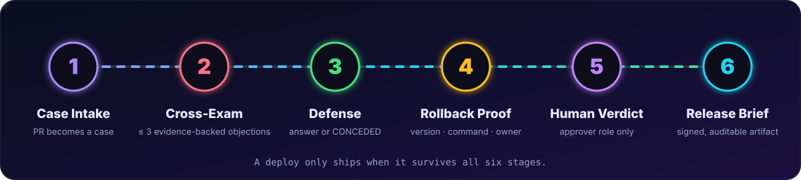</p>

| # | Stage | What happens |
|:-:|:--|:--|
| 1 | **Case Intake** | A developer proposes a release. The system convenes a courtroom in the shared Switch room `#ship-court`. |
| 2 | **Adversarial Cross-Examination** | The **Prosecutor** must formulate at most **3 evidence-backed objections**, using past failure precedent from the **Incident Historian**. |
| 3 | **Factual Defense** | The **Defender** must address every objection in order, or explicitly concede (`CONCEDED`). |
| 4 | **Guaranteed Reversibility** | The **Rollback Engineer** validates the target version, runbook command, health checks and owner. |
| 5 | **Exclusive Human Gate** | A human **Release Judge** holding the exclusive `approver` role issues a binding verdict: **APPROVE**, **BLOCK** or **SHIP WITH CONDITIONS**. |
| 6 | **Verifiable Artifact** | Switch registers the decision, assigns follow-up tasks to owners and publishes a signed **Release Brief**. |

<p align="center"></p>

## The Cast

<p align="center">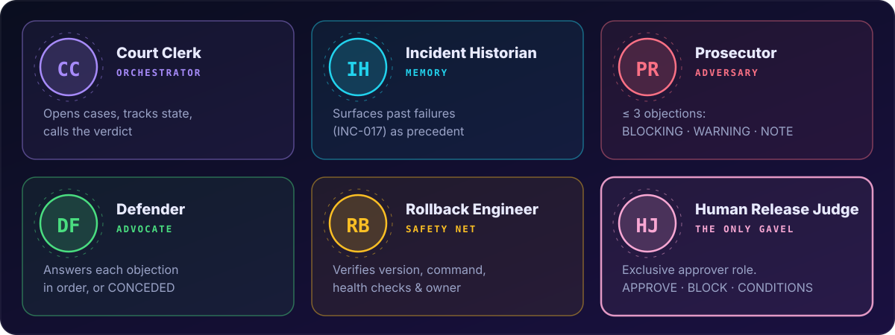</p>

| Agent | Role alias | Where it runs | Responsibility |
|:--|:--|:--|:--|
| **Court Clerk** | `clerk` | Always-on server host | Orchestrates the case, tracks state, calls for the verdict |
| **Incident Historian** | `historian` | Always-on server host | Searches incident memory and surfaces precedent (`INC-017`) |
| **Prosecutor** | `prosecutor` | Always-on server host | Files ≤ 3 objections classified `BLOCKING`, `WARNING` or `NOTE` |
| **Defender** | `defender` | Developer machine | Uses the local repo and tests to answer each objection or concede |
| **Rollback Engineer** | `rollback` | Developer / ops machine | Verifies version, command, health checks and owner |
| **Human Release Judge** | `approver` (exclusive) | A person | The only party that can approve, block or add conditions |

<p align="center"></p>

## The Trial

A full case from intake to signed verdict. The replay below loops.

<p align="center">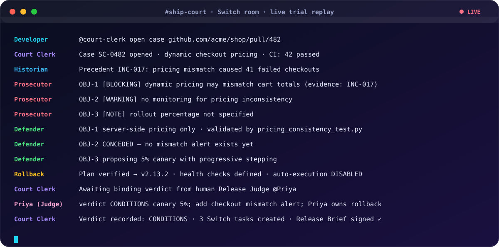</p>

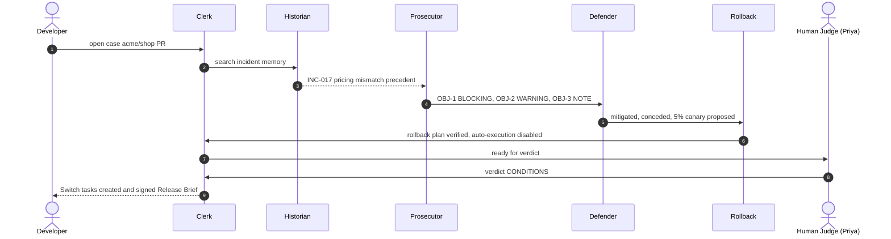

<details>
<summary><b>Read the full transcript</b></summary>

```text
Developer:              @court-clerk open case https://github.com/acme/shop/pull/482

Court Clerk:            Case SC-0482 opened. Change: dynamic checkout pricing.
                        Affected: checkout-service, cart-service, pricing-worker. CI: 42 passed.
                        @historian: Please search incident memory for relevant precedent.

Incident Historian:     Relevant precedent found: INC-017.
                        A pricing-related change on 2026-08-19 caused cart total mismatch
                        (41 failed checkouts).
                        Lesson: Require server-side pricing assertion and mismatch alert.
                        @prosecutor: Formulate objections based on precedent.

Prosecutor:             Prosecution Objections:
                        • OBJ-1 [BLOCKING]: Dynamic pricing may create cart-total mismatch. Evidence: INC-017.
                        • OBJ-2 [WARNING]:  No monitoring exists for pricing inconsistency. Evidence: Missing alert.
                        • OBJ-3 [NOTE]:     Rollout percentage is not specified.
                        @defender: Please address each objection in order or concede.

Defender:               Defense Responses:
                        • For OBJ-1: Pricing is calculated only server-side; validated by
                                     pricing_consistency_test.py.
                        • For OBJ-2: CONCEDED. No mismatch alert currently exists.
                        • For OBJ-3: Proposed 5% canary rollout with progressive stepping.
                        @rollback: Please produce validated rollback plan.

Rollback Engineer:      Rollback plan verified: target version: v2.13.2.
                        Command: ./scripts/rollback.sh checkout-service v2.13.2
                        Health checks: checkout error rate < 1%, cart latency < 400ms,
                                       pricing consistency job passes.
                        Rollback owner: Priya (Status: READY). Auto-execution is disabled.
                        @clerk: Ready for Release Judge.

Court Clerk:            Case ready for verdict. Unresolved blocking condition: pricing mismatch alert.
                        Awaiting binding verdict from Human Release Judge (@Priya).

Priya (Human Judge):    @court-clerk verdict CONDITIONS canary 5%; add checkout mismatch alert;
                        Priya owns rollback

Court Clerk:            Verdict recorded: CONDITIONS.
                        Switch Tasks Created:
                          1. Configure canary 5% rollout            — owner: Priya
                          2. add checkout mismatch alert            — owner: DevOps
                          3. Confirm rollback owner and rehearse    — owner: Priya
                        Signed Release Brief published to #ship-court.
```

</details>

<p align="center"></p>

## Why Switch Is Load-Bearing

If Switch is removed, the architecture fails the Track 01 requirements. The graphic flips Switch off every few seconds so you can watch what breaks.

<p align="center"></p>

| Switch capability | What it gives Ship Court | Without it |
|:--|:--|:--|
| **Durable room state** | `#ship-court` hosts the case timeline, agent identities and evidence logs | No shared memory, so no trial |
| **Multi-agent session routing** | Coordinates 5 agents across server, developer laptop and ops host | Agents cannot hand off across machines |
| **Exclusive `approver` role** | Only a verified human can issue verdicts; self-approval is rejected | Anyone, including an agent, could approve a deploy |
| **Task & decision storage** | Conditional verdicts become assigned, trackable Switch tasks | Conditions become forgotten chat messages |

<p align="center"></p>

## Architecture

<p align="center">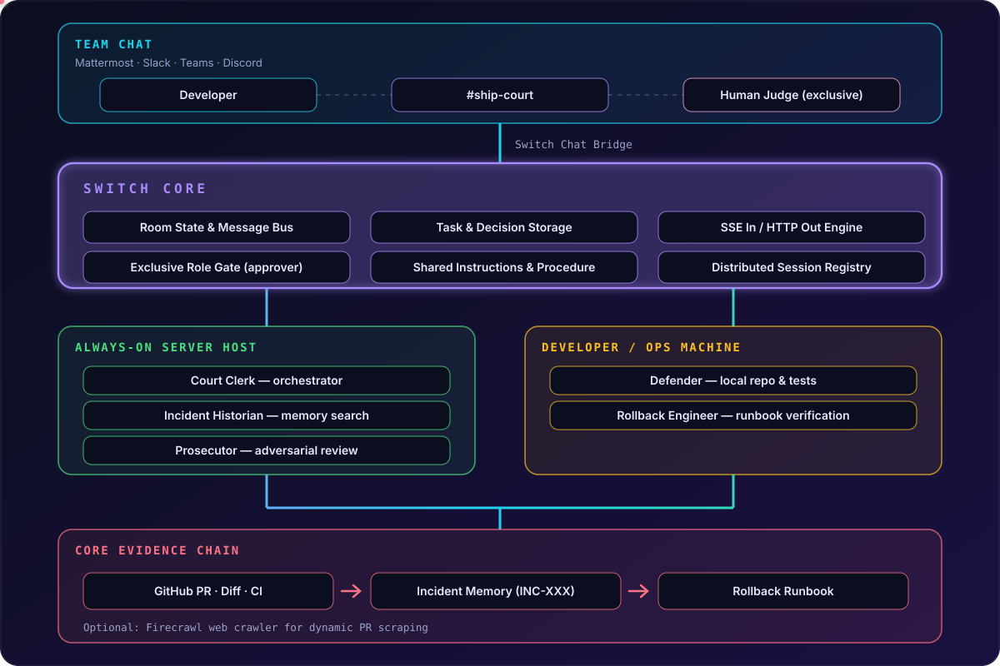</p>

### The unified lifecycle

The target design connects the courtroom to coding agents, a simulation stage and a voice-floor controller.

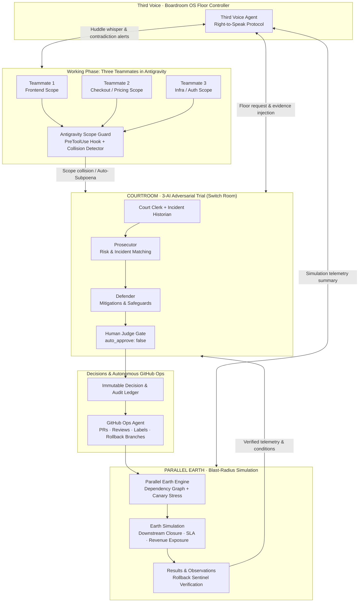

<details>
<summary><b>What exists in the repo today, and what each gap is</b></summary>

<br>

| Subsystem / path | Current state | Integration gap |
|:--|:--|:--|
| **Adversarial courtroom core** (`server/case_manager.py`, `server/live_courtroom_debate.py`) | 4-round pipeline: `EvidenceCollector` → `ProsecutorRuleEngine` → `DefenderRuleEngine` → `RollbackEngine` → `VerdictParser`. Live multi-provider LLM execution (Groq, OpenAI, Anthropic), real token budgets, human verdict enforcement (`enforce_human_verdict_gate`). | Triggered manually via CLI/HTTP instead of automatically on a scope collision or PR event. |
| **Switch room & native runner** (`server/switch_room.py`, `server/switch_native_runner.py`, `switch/ship-court.template.yaml`) | `AgentSession`, `RoomMessage`, role aliases (`clerk`, `historian`, `prosecutor`, `defender`, `rollback`) and the exclusive `approver` role. Declarative YAML with `{team}`, `{repository}`, `{provider}`, `{bridge}` parameters. | Missing registrations for `antigravity-guard`, `third-voice`, `parallel-earth`, `github-ops`. |
| **Chat webhook bridge** (`server/bridge_connector.py`) | Parses incoming webhooks and posts outgoing messages via `urllib.request`, with zero extra HTTP dependencies. | `forward_to_chat()` uses the Mattermost/Slack schema. Discord needs `content`, `username`, `embeds` and per-agent personas. |
| **Antigravity scope guard** (`linking_antigravity/scope_guard/`) | `PreToolUse` hook engine: `policy_engine.py`, `violation_detector.py`, `approval_handler.py`, `coordinator_adapter.py`, `multi_agent_demo.py`. Detects out-of-scope edits, collisions and path traversal. | `CoordinatorClient` talks to a mock coordinator on port 8000 instead of `SwitchRoom` and `CaseManager` on 8080. |
| **Dependency graph & rollback sentinel** (`server/dependency_graph.py`, `server/rollback_sentinel.py`) | Models 7 production services with Tier 1–3 SLAs, revenue/min exposure and downstream closure. | Not yet wired into a dedicated Parallel Earth stage that feeds the courtroom before sign-off. |
| **GitHub integration** (`server/evidence.py`) | Read-only PR metadata and diff scraping via the GitHub REST API. | No agent that writes back: branches, PR comments, verdict labels, rollback PRs. |

</details>

<p align="center"></p>

## Verification Dashboard

We separate what is **verified live** from what is **pending**.

| Capability | Status | Evidence / details |
|:--|:-:|:--|
| Groq provider credential | ✅ Live | HTTP 200 via `api.groq.com`, latency ~46 ms |
| Real 3-bot LLM courtroom | ✅ Live | Prosecutor, Defender and Judge produce unscripted LLM tokens |
| Local web console UI | ✅ Live | `http://127.0.0.1:8080/` with interactive debate and power meter |
| Switch template lint | ✅ Live | 0 errors, 0 warnings via `switch_core.template_lint` |
| Switch template planning | ✅ Live | 5 agents, aliases and approver role via `plan_template` |
| Human approver gate | ✅ Live | Non-human and unauthorized callers blocked |
| Documentation suite | ✅ Live | `runtime-discovery.md`, `integration-evidence.md`, `compliance-matrix.md` |
| Pytest suite | ✅ 42 passed | 42 passed, 1 skipped (ControlServer closed gate) |
| Docker Desktop engine | ⬜ Pending | Needs interactive UAC approval on Windows |
| Switch Console (Electron) | ⬜ Installed | `%LOCALAPPDATA%\Programs\Switch Console Canary` |
| Mattermost container bridge | ⬜ Awaiting Docker | `startNativeMattermost()` checks for the Docker engine |
| Live Switch-routed chat | ⬜ Awaiting Docker | Needs a containerized Mattermost `#ship-court` room |

> [!WARNING]
> **Live vs. simulation clarity.** The 3-bot courtroom runs with real live LLM inference and local web/API endpoints. End-to-end routing through containerized Mattermost stays blocked until Docker Desktop is approved on Windows.

<p align="center"></p>

## The 5 Superpowers

Beyond the verified Ship Court core, we are wiring the repo into one continuous **Ship Court × Boardroom OS × Antigravity × Parallel Earth** lifecycle.

<p align="center">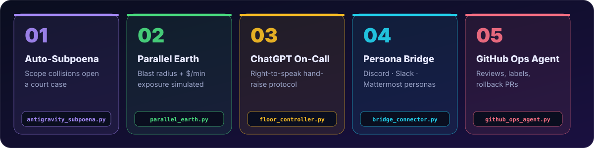</p>

> [!NOTE]
> The courtroom, Switch room, scope guard and dependency graph already live in the repo. The five modules below are the engineering plan that connects them. Each file path shows where the work lands.

<details>
<summary><b>1 · Antigravity Auto-Subpoena</b> — <code>server/antigravity_subpoena.py</code></summary>

<br>

Three teammates (`Teammate-1-Frontend`, `Teammate-2-Pricing`, `Teammate-3-Infra`) work in Antigravity with workspace boundaries enforced by `linking_antigravity/scope_guard`.

When one agent crosses a boundary (for example `Teammate-2-Pricing` editing `services/checkout-service/payment_contract.py`, owned by `Teammate-3-Infra`), `AntigravitySubpoenaBridge` intercepts the `ViolationEvent` / `ApprovalRequest`. Instead of failing silently in a local terminal, it posts a **Subpoena Notice** into the Switch-connected chat and calls `CaseManager.open_case()` to summon the courtroom.

**Why it matters:** it links coding agents on three separate machines into one shared governance loop, which is exactly what Switch is for.

</details>

<details>
<summary><b>2 · Parallel Earth blast-radius engine</b> — <code>server/parallel_earth.py</code></summary>

<br>

Before the human judge rules, `ParallelEarthSimulator` spins up a virtual staging twin using `DependencyGraph` and `RollbackSentinel`. It will:

- simulate synthetic traffic waves
- compute downstream service-cascade probability
- calculate financial exposure in **$/min** across Tier-1 services
- verify the rollback command restores health inside the SLA window
- post a structured `EarthSimulationReport` to the courtroom and chat

</details>

<details>
<summary><b>3 · Third Voice and the Right-to-Speak protocol</b> — <code>server/floor_controller.py</code></summary>

<br>

A deterministic `FloorRequestProtocol` state machine stops the AI from talking over humans:

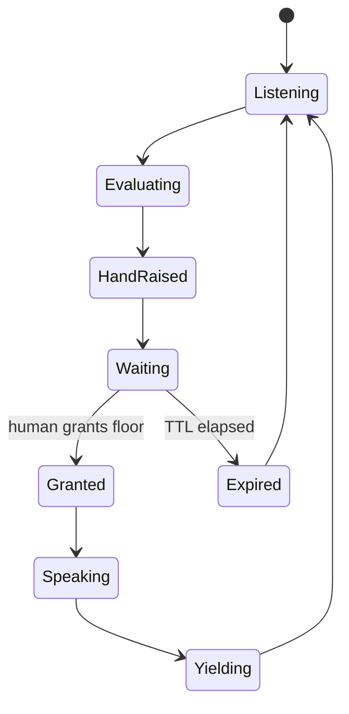

Third Voice watches three streams at once: **teammates / Antigravity** (undeclared scope drift), **the courtroom** (contradictions against previously approved decisions in `audit_ledger.py`, the *Contradiction Radar*) and **Parallel Earth** (unmitigated Tier-1 blast radius).

It raises a hand with an expiring card: **Grant Floor**, **Text Instead** or **Dismiss**. Only one AI agent can hold the floor at a time.

</details>

<details>
<summary><b>4 · Multi-persona Discord and Mattermost bridge</b> — <code>server/bridge_connector.py</code></summary>

<br>

`ChatBridgeConnector` gains auto-detection of Discord webhooks alongside Mattermost and Slack. Every agent role (`clerk`, `prosecutor`, `defender`, `judge`, `rollback`, `antigravity-guard`, `third-voice`, `parallel-earth`, `github-ops`) gets its own `username`, `avatar_url`, colour-coded `embeds` and action metadata, while staying backward compatible with `tests/test_bridge_connector.py`.

</details>

<details>
<summary><b>5 · Autonomous GitHub Operations agent</b> — <code>server/github_ops_agent.py</code></summary>

<br>

1. **PR review and evidence comments:** posts the courtroom transcript, Parallel Earth blast-radius tree and rollback plan onto the pull request.
2. **Governance labels:** `ship-court:approved`, `ship-court:conditional`, `ship-court:blocked`, `parallel-earth:verified`, `antigravity:scope-checked`.
3. **Condition issues:** a `CONDITIONAL` verdict opens a tracked issue per rollout condition.
4. **Emergency rollback PRs:** on post-merge degradation it opens a `rollback/<case_id>` branch and revert PR, still gated by `auto_approve: false`.
5. **Offline-safe mode:** uses the live GitHub REST API when `GITHUB_TOKEN` is set, otherwise a deterministic local ledger (`data/github_ops_ledger.json`) so judges can reproduce everything.

</details>

<details>
<summary><b>File-by-file implementation plan</b></summary>

<br>

| File | Action | Specification |
|:--|:--|:--|
| `server/bridge_connector.py` | Upgrade | Discord payload builder, persona mapping for all 8 agents, Mattermost/Slack/Discord support, `forward_to_chat(text)` stays backward compatible |
| `server/antigravity_subpoena.py` | New | Connects scope-guard events to `SwitchRoom` and `CaseManager`; opens a case on cross-teammate collisions |
| `server/parallel_earth.py` | New | `ParallelEarthSimulator` with dependency graph, canary load simulation, SLA breach modelling and feedback into the courtroom |
| `server/floor_controller.py` | New | `FloorRequestProtocol` state machine plus `ThirdVoiceAgent` contradiction radar |
| `server/github_ops_agent.py` | New | `GitHubOpsAgent`: PR reviews, labels, condition issues, rollback PRs, human-gate enforcement, offline ledger |
| `server/main.py` | Upgrade | New endpoints `/api/subpoena`, `/api/parallel-earth`, `/api/floor/raise`, `/api/floor/grant`, `/api/github/sync`, plus a `--full-lifecycle-demo` flag |
| `switch/ship-court.template.yaml` | Upgrade | Registers all unified agents (`{team}-court-clerk`, `-incident-historian`, `-prosecutor`, `-defender`, `-rollback-engineer`, `-antigravity-guard`, `-third-voice`, `-parallel-earth`, `-github-ops`) with scoped connections and the exclusive `approver` role |
| `tests/test_unified_superpowers.py` | New | `pytest` suite for the five superpowers, backward compatibility, approval gates and the full pipeline |

</details>

<p align="center"></p>

## End-to-End Lifecycle

<p align="center">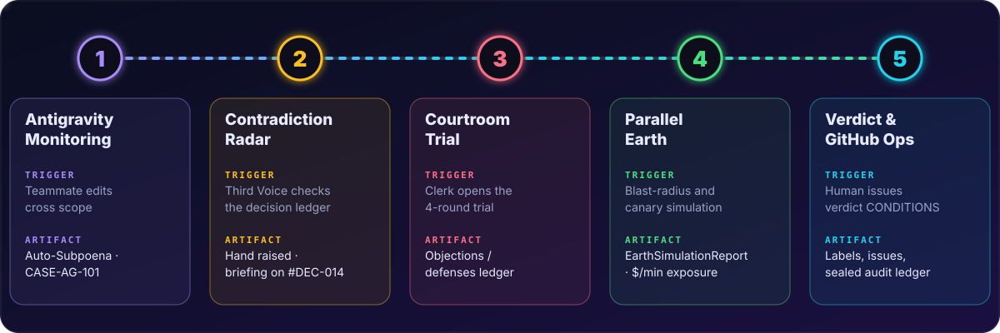</p>

| Phase | Trigger and actor | Switch handoff | Artifact |
|:--|:--|:--|:--|
| **1 · Antigravity monitoring** | Teammate 2 touches `pricing-engine` and `checkout-service` | `antigravity-guard` catches the cross-scope edit via `PreToolUse` and posts an **Auto-Subpoena** | `ViolationEvent` and Case `CASE-AG-101` |
| **2 · Contradiction radar** | `third-voice` cross-checks the edit against the decision ledger | Raises a high-priority hand; a human clicks **Grant Floor** | Signed `FloorRequest` and a 20-second briefing on conflict with `#DEC-014` |
| **3 · Courtroom trial** | `clerk` opens the 4-round trial | historian → prosecutor → defender | Objections and defenses ledger |
| **4 · Parallel Earth** | Courtroom asks for empirical blast-radius proof | `parallel-earth` runs `calculate_blast_radius()` and a canary probe | `EarthSimulationReport` with `$/min` exposure |
| **5 · Verdict and GitHub ops** | Human issues `!verdict CONDITIONS` | `enforce_human_verdict_gate()` dispatches `github-ops` | PR review, labels, condition issues, sealed audit ledger |

<p align="center"></p>

## Run It Yourself

```text
switch-AI/
├── .claude/skills/ship-court/   Claude skill for the courtroom workflow
├── .github/                     CI workflows
├── agents/                      Agent definitions
├── data/                        Incident memory and ledgers
├── demo/                        Demo assets
├── docs/                        runtime-discovery, integration-evidence, compliance-matrix
├── linking_antigravity/         Antigravity scope_guard (PreToolUse hook engine)
├── rooms/                       Switch room definitions
├── server/                      Courtroom, Switch room, bridge, dependency graph, rollback sentinel
├── switch/                      ship-court.template.yaml and validate_template.py
├── tests/                       pytest suite, stress and load tests
├── .env.example
├── requirements.txt
├── CLAUDE.md
└── LICENSE                      MIT
```

<details open>
<summary><b>1 · Clone and install</b></summary>

```bash
git clone https://github.com/GaneshNair007/switch-AI.git
cd switch-AI
pip install -r requirements.txt
```

</details>

<details>
<summary><b>2 · Validate the Switch template</b></summary>

```bash
python switch/validate_template.py
```

</details>

<details>
<summary><b>3 · Run the test suite</b></summary>

```bash
python -m pytest -v tests/
```

</details>

<details>
<summary><b>4 · 10-cycle continuous stress verifier</b></summary>

```bash
python tests/stress_and_health_check.py
```

</details>

<details>
<summary><b>5 · Switch-native courtroom runner</b></summary>

```bash
# Runs natively when Switch Console is installed, or with offline protocol fallback
python -m server.switch_native_runner
```

</details>

<details>
<summary><b>6 · Google Opal workflow bridge</b></summary>

```bash
python -c "from server.opal_workflow import GoogleOpalWorkflowBridge; print(GoogleOpalWorkflowBridge().execute_workflow())"
```

</details>

<details>
<summary><b>7 · Local multi-agent simulation</b></summary>

```bash
python -m server.local_courtroom_simulation
```

</details>

<details>
<summary><b>8 · High-concurrency stress test (20,000 requests)</b></summary>

```bash
# 20,000 requests across 100 worker threads
python tests/heavy_load_test.py -n 20000 -c 100
```

</details>

<p align="center"></p>

## The Artifact: Signed Release Brief

Every case ends in an auditable Release Brief stored with the case record.

<details>
<summary><b>See a sample brief (SC-0482)</b></summary>

```markdown
# Release Brief - SC-0482
Change: Dynamic checkout pricing
Repository: acme/shop
PR: #482
Requested by: Priya
Decision: SHIP WITH CONDITIONS

## Risk assessment
| # | Objection | Classification | Status | Evidence |
|---|---|---|---|---|
| 1 | Dynamic pricing may create cart-total mismatch between client and server. | BLOCKING | Mitigated | INC-017: client-side and server-side pricing divergence |
| 2 | No monitoring exists for pricing inconsistency. | BLOCKING | Open | No alert named pricing-mismatch in monitoring configuration. |
| 3 | Rollout percentage is not specified. | NOTE | Resolved | Deployment target specified canary without explicit traffic percentage. |

## Rollback plan
- Current version: v2.14.0
- Rollback target: v2.13.2
- Command: ./scripts/rollback.sh checkout-service v2.13.2
- Health checks: checkout error rate < 1%, cart-service p95 latency < 400ms, pricing consistency job passes
- Rollback owner: Priya
- Execution status: READY -- requires explicit human approval

## Conditions before full rollout
- [ ] Configure canary 5% rollout -- Priya
- [ ] add checkout mismatch alert -- DevOps
- [ ] Confirm rollback owner and rehearse rollback (rollback) -- Priya

## Decision record
- Judge: Priya
- Verdict: SHIP WITH CONDITIONS
- Switch room: #ship-court
- Case ID: SC-0482
```

</details>

<p align="center"></p>

## Built for the Judges

| Hackathon pillar | How Ship Court answers it |
|:--|:--|
| **Use of Switch (25%)** | Passes the Remove-Switch test: multiple agents across machines coordinate through one Switch room with role aliases and an exclusive `approver` gate. |
| **Technical execution (25%)** | Deterministic state machines (`CaseState`, `FloorState`), a 42-test pytest suite, a 20,000-request load test and offline-safe reproduction. |
| **Creativity and impact (25%)** | Track 01 (adversarial deploy court, GitHub Ops, Parallel Earth blast radius) meets Track 02 (Antigravity collision monitor, hand-raise protocol). |
| **Presentation and docs (25%)** | Interactive web console, declarative `ship-court.template.yaml`, a full docs suite and this README. |

<p align="center"></p>

## The Team

<p align="center"></p>

- **Arjit Ujjawal**
- **[Ganesh Nair](https://github.com/GaneshNair007)** (repository owner)
- **Jayvee Shah**

**Event:** [WeMakeDevs × DevTools Academy × Switch AI, Flip the Switch](https://www.wemakedevs.org/hackathons/switch) · **Primary track:** Track 01, Best Business Workflow · **Also targeting:** Track 02, Best Personal/Creative Workflow

**Links:** [Repository](https://github.com/GaneshNair007/switch-AI) · [Hackathon](https://www.wemakedevs.org/hackathons/switch) · [DevTools Academy](https://www.devtoolsacademy.com/hackathons/flip-the-switch) · [Switch runtime](https://github.com/sandbox-quantum/switch) · [Switch docs](https://docs.switchagents.ai/) · [MIT License](LICENSE)

<p align="center"></p>
