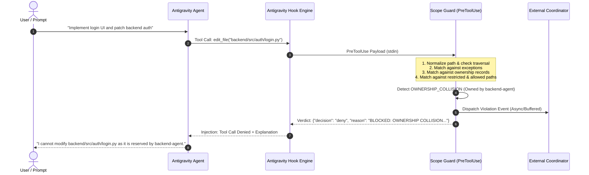

# Antigravity Agent Scope Guard — Architecture Specification

The **Antigravity Agent Scope Guard** is a specialized responsibility and permission enforcement layer built specifically for Google Antigravity agents operating within multi-agent collaborative software development systems.

It intercepts agent tool actions in real time, validates target files and commands against an assigned scope policy and cross-agent ownership reservations, issues explainable verdicts, and manages offline-resilient event dispatching and coordinator approvals.

---

## 1. System Architecture & Context

The Scope Guard sits directly at the boundary between the Antigravity Agent loop and the workspace filesystem, while maintaining a clean integration boundary with the external Coordinator.

```mermaid
flowchart TD
    subgraph AntigravityHost["Antigravity Host Environment (IDE / CLI / SDK)"]
        Agent["Antigravity Coding Agent (LLM)"]
        HookSubsystem["Lifecycle Hooks Subsystem (PreToolUse)"]
        RulesLoader["Rule Discovery Engine (.agents/rules/)"]
        AgentRules["agent_scope.md (Scope Priming Rules)"]
        
        Agent -->|Emits Tool Call\nwrite_file / edit_file / run_command| HookSubsystem
        RulesLoader -.->|Context Injection| AgentRules
        AgentRules -.->|Priming Instructions| Agent
    end

    subgraph ScopeGuard["Antigravity Agent Scope Guard (This Component)"]
        HookHandler["Hook Handler (STDIN/STDOUT Contract)"]
        Engine["Scope Policy Engine\n• Path Normalizer & Traversal Defense\n• Glob Pattern Matcher (**)\n• Ownership Checker"]
        AssignClient["Assignment Client\n• Local Cache (.scope_guard/)\n• Version Freshness\n• Dynamic Scope Loader"]
        ViolationDet["Violation Detector\n• Category Classifier\n• Severity Assessor\n• Explainability Formatter"]
        ApprovalHdlr["Approval Handler\n• Scope Expansion Requests\n• Version Management"]
        EventRep["Event Reporter\n• Persistent Spool (audit.jsonl)\n• Offline Buffer (pending.jsonl)\n• Auto-Retry Flusher"]
        SDKInteg["SDK Policy Provider\n• policy.deny predicates\n• @hooks.pre_tool_call_decide"]
        
        HookSubsystem -->|PreToolUse Payload (JSON)| HookHandler
        HookHandler -->|Action Request| Engine
        AssignClient -->|Active Assignment| Engine
        Engine -->|ALLOW / BLOCK / ASK / WARN| HookHandler
        Engine -->|Violation Decision| ViolationDet
        ViolationDet -->|Structured Event| EventRep
        ApprovalHdlr -->|Updated Scope| AssignClient
        SDKInteg --> Engine
        HookHandler -->|JSON Verdict\n{decision: deny/allow/ask}| HookSubsystem
    end

    subgraph ExternalSystem["External Multi-Agent System (Context Only)"]
        Coordinator["Coordinator Backend API\n• Assignment Source\n• Ownership Table\n• Approval Authority"]
        Switch["Switch (Agent-to-Agent Comms)"]
        Discord["Discord / Team Notifications"]
        Courtroom["Courtroom (Diff Evaluator)"]
    end

    EventRep -->|POST /api/v1/violations\n(Buffered on failure)| Coordinator
    ApprovalHdlr -->|POST /api/v1/approvals| Coordinator
    AssignClient -->|GET /api/v1/agents/{id}/assignment| Coordinator
```

---

## 2. Decision Flow Sequence Diagram

The following sequence illustrates the complete lifecycle of an intercepted action:



---

## 3. Modular Responsibilities

| Module | Location | Primary Responsibility |
| :--- | :--- | :--- |
| **Data Schemas** | `scope_guard/schema.py` | Data contracts: `Assignment`, `PolicyDecision`, `ViolationEvent`, `ApprovalRequest`, `ApprovalResponse`. |
| **Policy Engine** | `scope_guard/policy_engine.py` | Path normalization, traversal security, recursive glob matching (`**`), exception checking, ownership resolution. |
| **Violation Detector** | `scope_guard/violation_detector.py` | Classifies violations (`OUT_OF_SCOPE_MODIFICATION`, `OWNERSHIP_COLLISION`, `RESTRICTED_PATH_ACCESS`, `PATH_TRAVERSAL_ATTEMPT`, `DESTRUCTIVE_COMMAND`, `UNAUTHORIZED_SCOPE_EXPANSION`), formats human-readable explanation reports. |
| **Assignment Client** | `scope_guard/assignment_client.py` | Manages local persistent caching (`.scope_guard/current_assignment.json`), version freshness verification, and coordinator sync. |
| **Event Reporter** | `scope_guard/event_reporter.py` | High-reliability persistent event queue (`audit.jsonl` and `pending.jsonl`), resilient to network outages with automatic retry flushing. |
| **Approval Handler** | `scope_guard/approval_handler.py` | Creates structured out-of-scope requests, applies coordinator updates, bumps assignment version, updates active rules. |
| **Coordinator Adapter** | `scope_guard/coordinator_adapter.py` | Resilient HTTP adapter (`urllib.request`) for coordinator endpoints, supporting socketless test transports. |
| **Mock Coordinator** | `scope_guard/mock_coordinator.py` | Complete in-memory and HTTP mock server for testing, simulation, and offline demonstration. |
| **Antigravity Hooks** | `scope_guard/antigravity/hook_handler.py` | Antigravity `PreToolUse` hook processor converting stdin/stdout to engine evaluations. |
| **SDK Integration** | `scope_guard/antigravity/sdk_integration.py` | Adapters for `google-antigravity` Python SDK (`policy.deny` and `@hooks.pre_tool_call_decide`). |
| **Rule Generator** | `scope_guard/antigravity/rules_generator.py` | Compiles assignments into discoverable `.agents/rules/agent_scope.md` files. |
| **CLI & Tools** | `scope_guard/cli.py`, `bin/scope-guard-hook` | CLI interface and shell script executable for Antigravity host integration. |

---

## 4. Security & Isolation Boundaries

1. **Path Traversal Defense**:
   All paths undergo canonical path normalization and relative resolution against the active workspace root.
   Attempts to escape via `../`, absolute root escapes (`/etc/passwd`), embedded null bytes (`\0`), or URL encodings (`%2e%2e`) are immediately classified as `PATH_TRAVERSAL_ATTEMPT` with `CRITICAL` severity and blocked unconditionally.

2. **Fail-Closed Execution**:
   If an unexpected error, unparsable payload, or corrupted configuration is encountered inside the hook, the Scope Guard outputs `{"decision": "deny"}` to protect the codebase from unauthorized modifications.

3. **Offline Resilience**:
   Coordinator network failures never disrupt or crash the agent tool execution. Violations and audit trails are spooled locally in `.scope_guard/events/pending.jsonl` and dispatched automatically once connectivity is restored.
